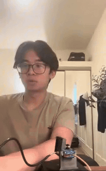
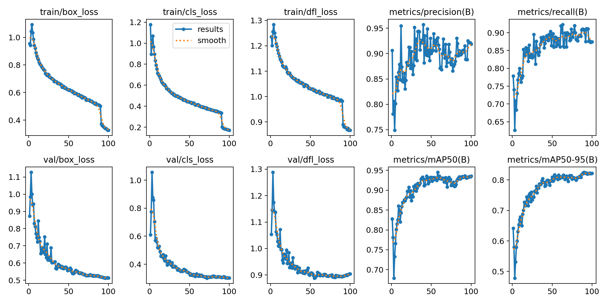
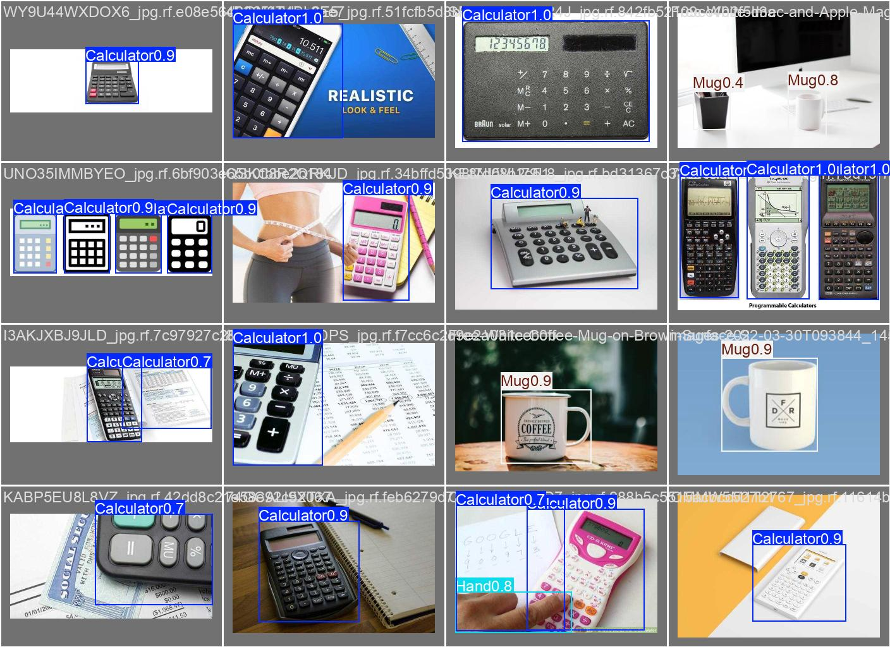
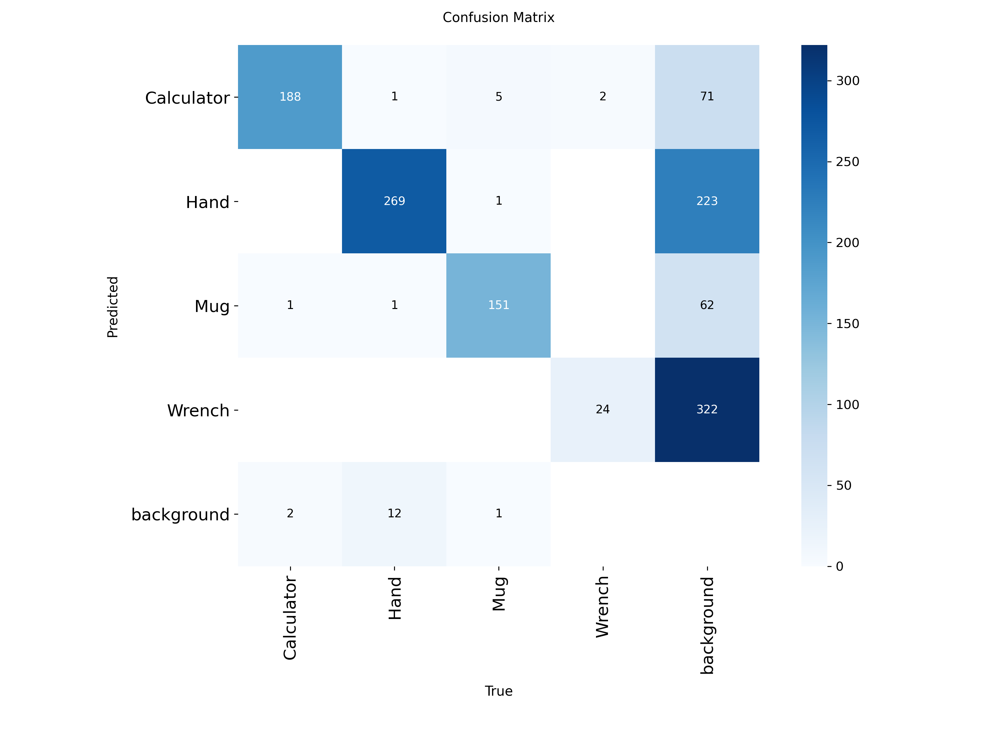

# Pan-Tilt Object Tracking Robot

A camera on a two-servo mount that finds a chosen object with a custom-trained YOLOv8 model and turns to keep it centered in frame. Everything runs on a Raspberry Pi 4.

I built this over about three months, starting from no computer vision background, as a way to learn the full path from NumPy arrays to a model deployed on hardware.

**Status:** working. The robot tracks with a retrained model, with results and a demo below.

## Demo

Full video on [YouTube](https://youtube.com/shorts/TGTJDFGm-Ts).

## How it works
1. **Detect.** Each frame goes through a YOLOv8 nano model exported to NCNN, which is the format that runs fastest on the Pi's ARM CPU.
2. **Filter.** Detections are narrowed to the current target class, and the most confident one is tracked.
3. **Measure the error.** The box center is compared with the frame center to get an offset in pixels.
4. **Convert to an angle.** The camera's 102° horizontal field of view gives degrees per pixel, so the pixel offset becomes the angle the mount needs to turn.
5. **Move.** Each servo moves 30% of the way toward the target per frame, which smooths the motion, and ignores errors under 1° so it does not twitch when the object is already centered.

The target can be changed while the program runs by typing a class name into the terminal. That input is read on a separate thread so the video loop never blocks waiting for it.

## Model and results

The detector is a YOLOv8 nano model trained for 100 epochs at 320x320 on four classes I labeled in Roboflow: calculator, hand, mug, and wrench. It is exported to NCNN for the Pi.

Training code is in [`training/YOLOv8_Object_Detection_Training.ipynb`](training/YOLOv8_Object_Detection_Training.ipynb).

| Metric | Validation score |
|---|---|
| Precision | 0.919 |
| Recall | 0.874 |
| mAP50 | 0.936 |
| mAP50-95 | 0.822 |

| Predictions on validation images | Confusion matrix |
|---|---|
|  |  |

The first version ran as ONNX at about 2 frames per second, which was too slow to follow a moving object, so I exported to NCNN at a smaller input size to speed it up.

## Hardware

| Part | Qty | Notes |
|---|---|---|
| Raspberry Pi 4 Model B | 1 | Runs detection and servo control |
| Inno-Maker U20CAM-720P | 1 | USB camera, 102° horizontal FOV |
| SG90 9g micro servo | 2 | Pan on GPIO 17 (0 to 180°), tilt on GPIO 27 (0 to 100°) |
| 4-cell AA battery holder | 2 | Powers the servos separately from the Pi |
| 3D-printed pan-tilt mount | 1 | Designed in Onshape, STL files in [`cad/`](cad) |

Servos are driven through `pigpio` instead of the default software PWM, which removed most of the jitter I saw in early tests.

## Build log

### July (27th to 31st): NumPy and image fundamentals
- Learned NumPy array creation, slicing, reshaping, and data types, like uint8.
- Created practice challenges (with Claude's help) to apply the syntax and concepts I learned.
- Learned how images are stored as NumPy arrays.
- Did basic image processing with arrays: isolating color channels, cropping, inverting, and rotating.

### August: OpenCV and PyTorch fundamentals
- Learned core OpenCV techniques, like thresholding, masking, contour and edge detection, color space conversion, and live video processing.
- Used HSV color space to isolate and track a specific color in a live webcam feed.
- Built an HSV mask to find the approximate center pixel of a tracked object with specific colors.
- Started learning PyTorch tensors and how they compare to NumPy arrays.
- Recapped and learned more Linux command-line commands to make navigating the Pi easier, and took notes on them.
- Set up the Raspberry Pi headless, using Raspberry Pi Connect.
- Set up the initial pan-tilt rig using the Pi's GPIO pins, SG90 servo motors, and separate batteries for power.
- Had Claude write a quick test script for testing servos.

### September: hardware setup and model training
- Used Roboflow to upload and label images (initially hairbrush, TV remote, wallet).
- Looked over a guide on Ultralytics and trained a model.
- Used Google Colab to train a custom YOLOv8 nano model on a T4 GPU.
- Looked at a quick overview of the GPIO library.
- Began writing the object detection script.
- While writing the script, began modeling the physical pan-tilt mount in Onshape.
- Added runtime target switching on a separate thread.

### October: tracking and retraining
- Added more varied images to the dataset, which made recognition on the robot more reliable even though validation mAP50 dropped from 0.952 to 0.936.
- Switched the model from ONNX to NCNN to raise the frame rate on the Pi.
- Lowered the deadband from 8° to 1°, which had been causing the mount to move in large steps.
- Switched servo control to gpiozero's pigpio pin factory, so servo pulses are timed by a separate daemon instead of my script.

## Learning resources

**NumPy**
- https://www.youtube.com/watch?v=QUT1VHiLmmI
- https://www.classcentral.com/classroom/youtube-image-processing-with-python-54897 (videos 1 and 2)

**OpenCV**
- https://www.youtube.com/watch?v=oXlwWbU8l2o&list=LL&index=15&t=7344s

**PyTorch and neural networks**
- https://docs.pytorch.org/tutorials/beginner/basics/quickstart_tutorial.html
- https://www.youtube.com/watch?v=aircAruvnKk&list=PLZHQObOWTQDNU6R1_67000Dx_ZCJB-3pi (videos 1 to 3)

**Linux and Raspberry Pi**
- https://www.youtube.com/watch?v=ZtqBQ68cfJc&t=10455s
- https://pinout.xyz

**Roboflow and Ultralytics**
- https://www.youtube.com/watch?v=a3SBRtILjPI&t=221s
- https://academy.ultralytics.com/courses/train-your-first-yolo
- https://docs.ultralytics.com/guides/model-evaluation-insights
